# Tideover

[](https://github.com/kadhim-alawi/paypal-hackathon/actions/workflows/ci.yml) [](LICENSE)

**Emergency cash in minutes, not months.**

Tideover is the operating system for community emergency funds: mutual aid groups, campus emergency grants, church and neighborhood relief funds. A neighbor with a shut-off notice talks to an AI caseworker in their own language, snaps a photo of the bill, connects their PayPal or Venmo, and a volunteer approves the grant with one tap. PayPal Payouts delivers the money, and every donor can watch it arrive on a public ledger.

> **AI proposes, people decide, rules enforce.** Claude reads the story and the documents and writes the case file. A human approves. Deterministic code enforces the fund's caps, balance, duplicate checks and two-person rule, and the AI cannot override any of them.

**Live demo:** _add your Render URL here_ · **Video:** _add your YouTube link here_ · **License:** MIT

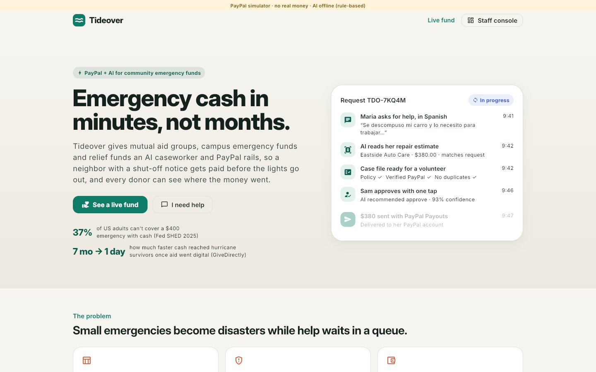

---

## The problem

- **37% of U.S. adults can't cover a $400 emergency with cash**, and 4 in 10 adults earning under $50,000 couldn't cover even $100 from savings ([Federal Reserve, SHED 2025](https://www.federalreserve.gov/publications/2026-economic-well-being-of-us-households-in-2025-executive-summary.htm)).
- Small emergencies become disasters while help waits in a queue: a $380 brake repair is the difference between keeping and losing a warehouse job, and a $286 power bill is the difference between a working fridge and a newborn without one.
- The groups that step in, from mutual aid networks to campus emergency funds, run on spreadsheets, group chats and personal Venmo accounts. Volunteers burn out on intake and paperwork, fraud and duplicates slip through, applicants wait anxiously for days, and donors never see where the money went ([New America's guide to emergency cash funds](https://www.newamerica.org/insights/establishing-emergency-cash-assistance-funds/implementing-your-program/) documents these trade-offs).
- Speed matters. [GiveDirectly reports](https://www.givedirectly.org/hurricane-relief-2022) that its earlier U.S. hurricane process took **7 months** to pay 6,363 recipients; with data-driven targeting and remote enrollment, more than 90% were paid **in under 24 hours**.

Tideover gives a five-volunteer fund the speed of GiveDirectly with the controls of a grant office.

## What it does

### For a neighbor in need (mobile-first web app, also builds for iOS/Android)

| | |
|---|---|
| 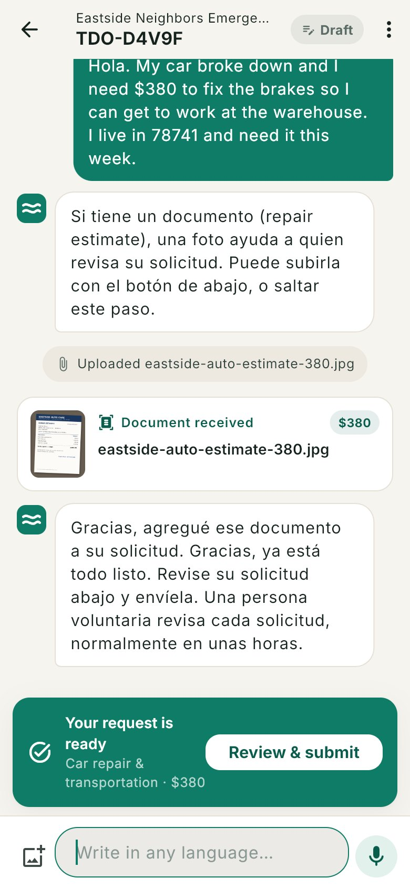 | **Ask for help in any language.** A Claude caseworker asks only what the fund's policy needs, by text or voice. The app's own screens switch to Spanish when that's the person's language (shown here). A photo or PDF of a bill or estimate is read on the spot: who issued it, the amount, the due date, and whether it matches the story. No account, no Social Security number. |
| 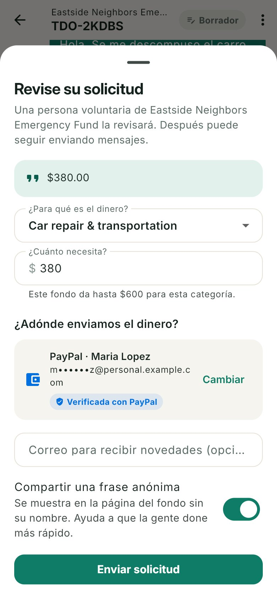 | **Verified payout in two taps.** *Log in with PayPal* proves the applicant controls a verified PayPal account, so the grant goes to a PayPal payer ID rather than a typed email. Venmo (phone) and PayPal email also work. |
| 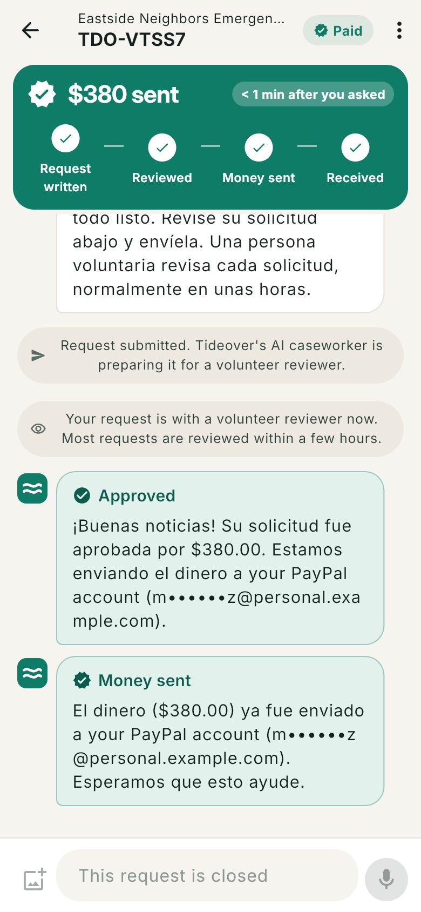 | **Live status, then cash.** The request page updates in real time: submitted, reviewed, money sent, received. The decision message arrives in the applicant's language. |

### For organizers and reviewers (staff console)

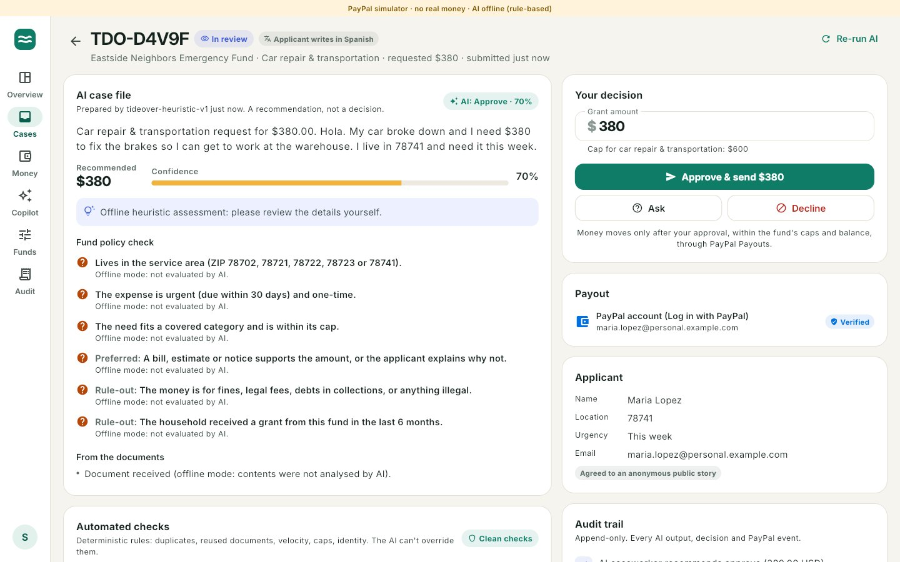

- **AI case file:** a summary, a recommended amount, a confidence score, and a line-by-line check of the fund's own policy with evidence quoted from the conversation and documents.
- **Automated checks that the AI can't override:** cooldown since the last grant, duplicate open requests, the same document reused across requests, near-identical stories, request velocity, category caps, amount mismatches against documents, and unverified payout accounts.
- **One-tap decisions** with the money rules built in: approve-and-send, ask for more information, or decline with a reason the applicant receives in their language. Grants above a threshold need **two different reviewers**. Optional auto-approval only fires for small, clean, document-backed requests to verified PayPal accounts.
- **Money:** every PayPal capture and payout with batch and transaction IDs, fees, and settlement time; payouts are tracked until final (unclaimed ones until they're claimed or PayPal returns them), and failed payouts can be retried.
- **Policy compiler:** paste the fund's rules in plain English and Claude turns them into the structured rubric (categories, caps, required evidence, cooldown) that both the AI and the deterministic checks use.
- **Treasurer copilot:** ask "how much can we still grant this week?" or "reconcile us with PayPal for the last 7 days". It answers from live data through Tideover tools and the official **PayPal Agent Toolkit**, and refunds always need explicit confirmation.
- **Treasurer Ledger (AG Grid):** every dollar in and out as a live spreadsheet (fund, type, net, category, donor or case, PayPal ID, status), with filtering, drag-to-group totals, pivoting and CSV/Excel export. **Ask the ledger** in plain English: "total grants by category" goes to Claude together with the grid's own state schema from **AG Grid's AI Toolkit**, and the answer is applied to the grid, which regroups and totals itself. Claude never computes the numbers; the grid does.
- **Append-only audit log** of every AI output, human decision, PayPal call and webhook.

| 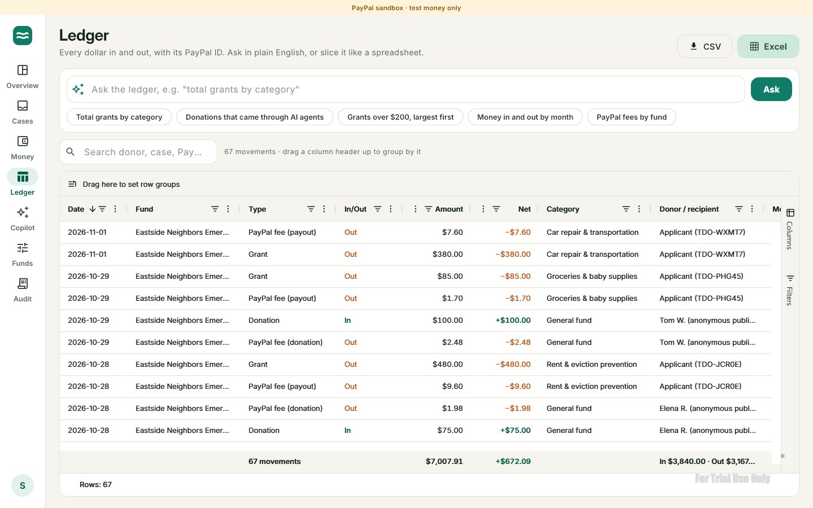 | 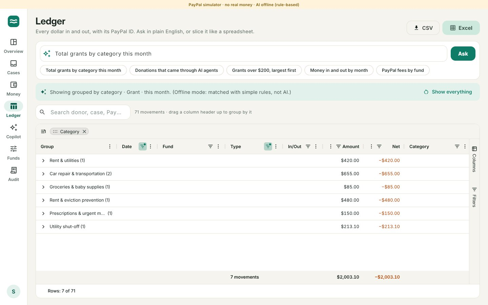 |
|---|---|

| 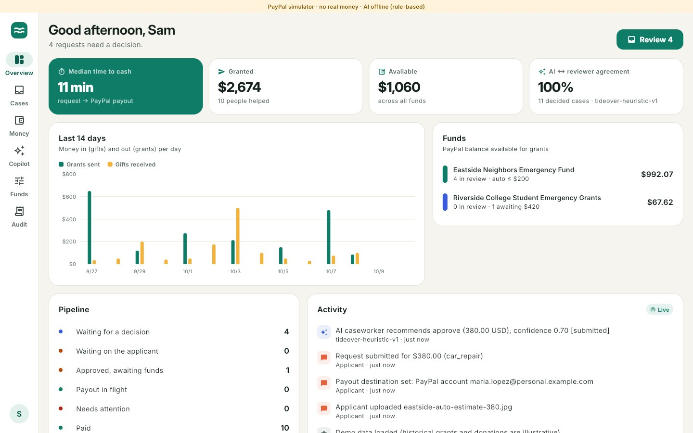 | 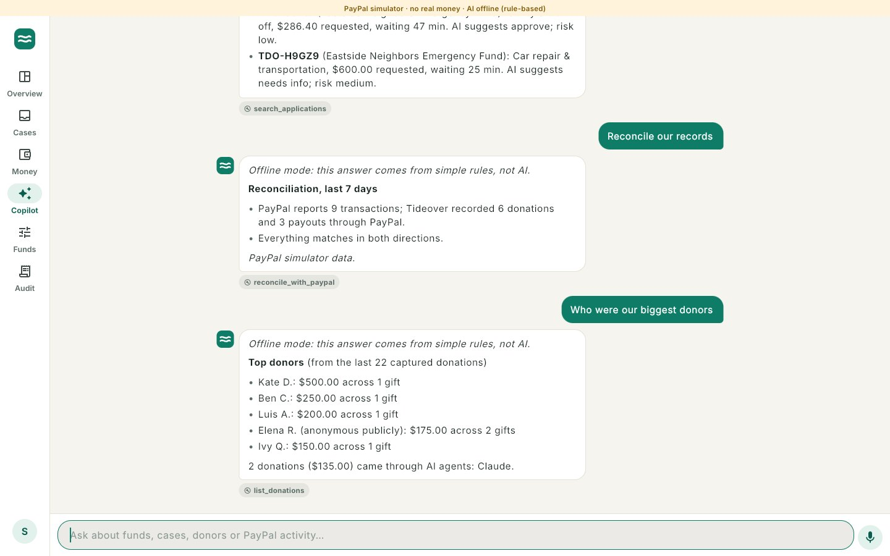 |
|---|---|
| 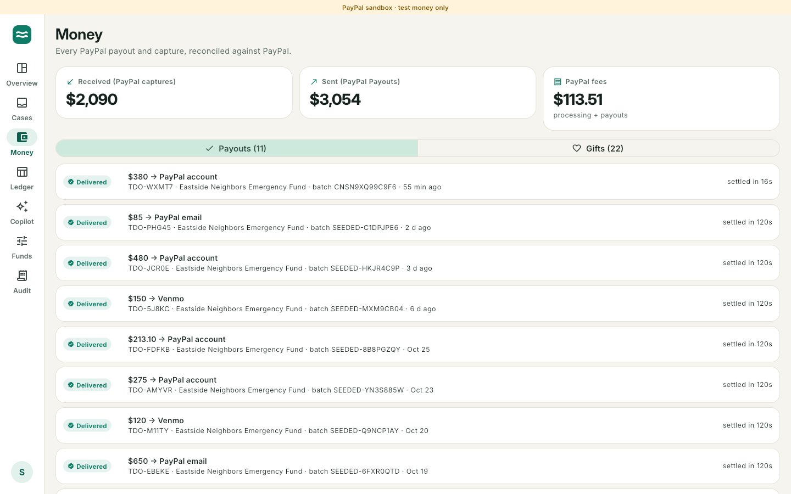 | 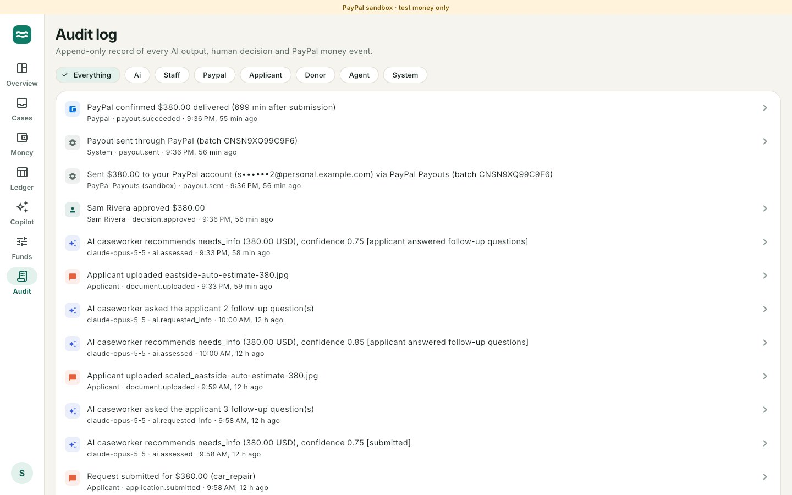 |

### For donors, and for donors' AI agents

- **Public fund pages** show the live ledger: every gift and grant (anonymized, with consent-based one-line stories), the fund's balance, and the median minutes from request to cash.
- **Fund a specific need:** when a request is approved but the fund is short, it appears on the page. A donor's PayPal or Venmo payment (PayPal JS SDK Smart Buttons) is captured and the grant pays out **immediately**, and the donor watches it arrive.
- **Agentic giving over MCP:** Tideover runs a Model Context Protocol server at `/mcp`. An assistant like Claude can list funds, find approved needs and start a donation. It gets back a PayPal checkout link that the human approves, so nothing is charged without the person. Agent-initiated gifts are labelled as such in the books. Try it from a terminal with the included donor agent: `npm run agent -- "Give $25 to an approved need"`.

| 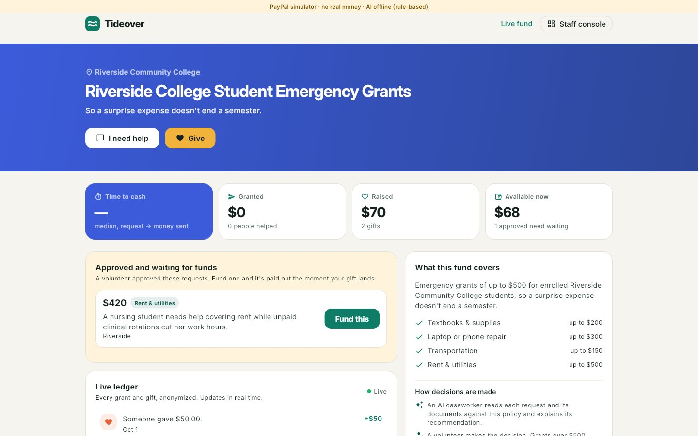 | 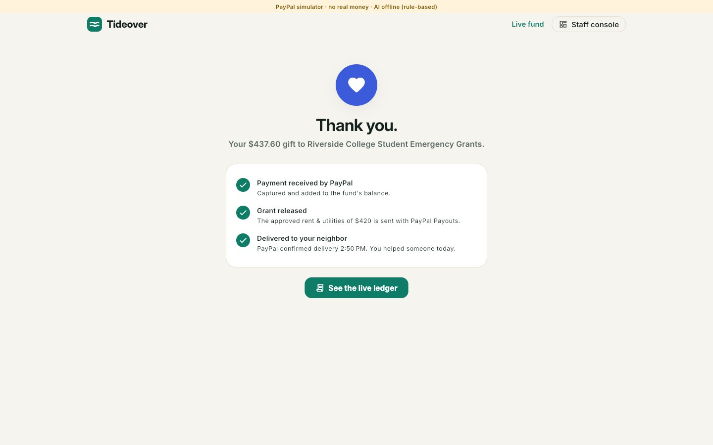 |
|---|---|

## How PayPal and AI are used

| PayPal | Where |
|---|---|
| **Payouts API** (PayPal, Venmo, `PAYPAL_ID` recipients) with `sender_batch_id` + `PayPal-Request-Id` idempotency | Every grant; poller + webhooks drive it to a final state |
| **Orders v2** create/capture/get, **JS SDK** Smart Buttons (PayPal, Venmo, Pay Later, cards) | Donations and sponsored needs |
| **Log in with PayPal** (`userinfo`, `schema=paypalv1.1`) | Verifies the applicant's account; payouts go to the payer ID |
| **Webhooks** with signature verification | `PAYMENT.PAYOUTS-ITEM.*`, `PAYMENT.PAYOUTSBATCH.*`, `CHECKOUT.ORDER.APPROVED`, `PAYMENT.CAPTURE.COMPLETED/REFUNDED/REVERSED` |
| **Refunds** (captures) | Copilot, with explicit confirmation, admins only |
| **Transaction Search** (Reporting API) | Two-way reconciliation of Tideover's books against PayPal |
| **PayPal Agent Toolkit** (`@paypal/agent-toolkit`) | Tools for the treasurer copilot |

| AI (Claude, `claude-opus-5-5`) | Where |
|---|---|
| Streaming **tool-use agent** (`record_details`, `request_document`, `mark_ready`) | Applicant intake chat, any language |
| **Vision** on photos and PDFs with **structured outputs** | Reads bills, estimates and notices; flags inconsistencies |
| **Structured outputs** with high effort | Case assessment against the fund's rubric; policy compiler |
| Agent with Tideover tools + PayPal Agent Toolkit | Treasurer copilot |
| Short generation | Decision messages in the applicant's language; anonymized impact stories |

| Also built with | Where |
|---|---|
| **AG Grid Enterprise** + **AI Toolkit** (`getStructuredSchema` → Claude structured output → `setState`) | Treasurer Ledger |
| **Render** (Blueprint, Docker web service, Render Postgres) | Hosting |

Prompt caching keeps the long policy prompts cheap, server-side fallbacks keep requests flowing through model overloads, and effort is tuned per task. Every AI call has a deterministic fallback, so the product keeps working (clearly labelled) if the AI is unavailable.

## Try it

### Access for judges

| | |
|---|---|
| Hosted demo | _add your Render URL here_ |
| Staff console | `/console` → **Sign in as Sam (reviewer)** or **Avery (admin)**, one click (`reviewer@tideover.app` / `tideover-review`, `admin@tideover.app` / `tideover-admin`) |
| PayPal sandbox buyer (donations, Log in with PayPal) | _sandbox personal account email_ / _password_ (test credentials, fake money) |
| Sample documents to upload | [`demo-assets/`](demo-assets/) |
| AI agent giving | `cd server && ANTHROPIC_API_KEY=... npm run agent -- --url <demo URL> "Give $25 to an approved need"` |

No keys are needed to run it locally: without them it runs fully offline with the PayPal simulator (see *Run it locally*).

### Judge's tour (about 5 minutes)

1. **Apply:** open the Eastside fund, choose **I need help**, and write something like *"Hola, se me descompuso el carro y necesito $380 para los frenos"*. Attach `demo-assets/eastside-auto-estimate-380.jpg` (sample documents are in [`demo-assets/`](demo-assets/)). Connect PayPal, pick **Maria Lopez** on the PayPal page, and submit. Keep this tab open.
2. **Review:** in another window open `/console` and choose **Sign in as Sam (reviewer)**. Open the new case, read the AI case file and checks, and press **Approve & send**. The applicant tab flips to *Money sent* within seconds.
3. **Give:** open the Riverside College fund, press **Fund this** on the waiting need, and pay with PayPal. The grant pays out the moment your gift is captured.
4. **Operate:** open the **Ledger** and tap *Total grants by category*, then try your own question or drag a column up to group by it. Look at **Money** (PayPal IDs and fees), **Audit**, **Funds** (try the policy compiler), and ask the **Copilot** to reconcile with PayPal.
5. **Two-person rule:** Darnell's $750 rent case is over the $500 threshold, so it needs two different reviewers. Approve it as Sam, then sign out and approve again as **Avery (admin)**. If the fund's balance is short, the approved grant waits for donations and appears as a need on the public fund page, where any donor can fund it.

A banner on every page states the mode. In **simulator mode** (no PayPal credentials), an in-process emulator of the PayPal APIs plays PayPal, including the checkout and login pages, so the full journey runs with no keys. With sandbox credentials, the same code talks to the real PayPal sandbox.

### Run it locally

Requirements: Node 22+ and a current stable Flutter (3.47+, Dart 3.13) for the web build.

```bash
# 1. Build the web app (served by the API)
cd app && flutter pub get && flutter build web --release --no-web-resources-cdn

# 2. Start the API (embedded Postgres, seeded demo data)
cd ../server && npm ci && cp .env.example .env && npm run dev

# 3. Open http://localhost:8080

# Optional: build the AG Grid bundle for the Ledger (otherwise it loads from a CDN)
cd ../tools/aggrid && npm ci && npm run build   # then rebuild the web app
```

With an empty `.env` everything runs offline (PayPal simulator + rule-based AI). Add keys to switch on the real thing:

- `ANTHROPIC_API_KEY` turns on Claude. Check it with `npm run verify:claude`.
- `PAYPAL_CLIENT_ID` + `PAYPAL_CLIENT_SECRET` (+ `PAYPAL_WEBHOOK_ID`) switch to the PayPal sandbox. Check every PayPal API Tideover uses with `npm run verify:paypal`. Step-by-step sandbox setup is in **[docs/PAYPAL_SETUP.md](docs/PAYPAL_SETUP.md)**.
- `AG_GRID_LICENSE_KEY` removes the AG Grid Enterprise evaluation watermark in the Ledger. Everything works without it.

For the mobile app: `cd app && flutter run --dart-define=API_BASE=http://10.0.2.2:8080` (Android emulator) or your machine's LAN address.

### Deploy (Render, one blueprint)

[`render.yaml`](render.yaml) creates a Docker web service and a Postgres database. In Render choose **New → Blueprint**, pick this repo, and fill in the PayPal and Anthropic secrets when prompted. The [`Dockerfile`](Dockerfile) builds the Flutter web app and the server into one image. Afterwards, point your PayPal app's webhook and *Log in with PayPal* return URL at the Render URL (see [PAYPAL_SETUP.md](docs/PAYPAL_SETUP.md#5-deploy-and-point-paypal-at-it)).

Staff sign-in: `admin@tideover.app` / `tideover-admin` and `reviewer@tideover.app` / `tideover-review`. While these defaults are in use the console offers one-click demo sign-in; set `ADMIN_PASSWORD` and `REVIEWER_PASSWORD` to lock it down.

## Architecture

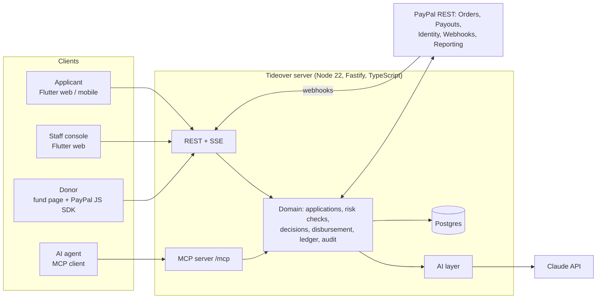

- **Money safety:** a payout is only created for an approved request, never above the approved amount, never beyond the fund's ledger balance (per-fund lock), and idempotently (one `sender_batch_id` per payout, retried with the same `PayPal-Request-Id`). Webhooks and polling converge on the same state machine.
- **Realtime:** applicant pages, fund pages and the console update over Server-Sent Events.
- **One codebase, two PayPals:** the domain talks to a `PayPalGateway` interface; the REST client and the simulator implement the same wire formats, state machines and error shapes.

More detail in **[docs/ARCHITECTURE.md](docs/ARCHITECTURE.md)**.

## Quality

- `cd server && npm test`: 49 tests covering the applicant journey, the Ledger (rows reconcile to fund balances; questions become schema-valid AG Grid state, through both Claude paths and the offline rules), Spanish-language applicants, approvals and the two-person rule, sponsored needs, risk checks, webhooks (including signature verification), MCP, reconciliation, the PayPal REST client against recorded wire formats, and the Claude provider against a fake Messages API (streaming tool loop, structured outputs, vision, fallbacks).
- `cd app && flutter test`: unit and widget tests for formatting and the chat Markdown renderer. CI runs both suites, `flutter analyze` and the web build on every push.
- `e2e/journey.mjs` drives the real UI end to end with Playwright: apply in Spanish with a document → Log in with PayPal → submit → reviewer approves → payout → applicant sees *Paid*; donor funds a need → instant grant; the Ledger answers a question by regrouping itself; console pages.
- `npm run verify:paypal` and `npm run verify:claude` run live checks against your sandbox app and API key.

## Repository layout

```
app/          Flutter app (web + iOS/Android): applicant, donor and staff experiences
server/       Fastify API, domain logic, PayPal gateway + simulator, AI layer, MCP server, tests
demo-assets/  Fictional sample documents for trying the document reader
docs/         Architecture, PayPal setup, demo script, submission text, screenshots
e2e/          Playwright journeys
tools/aggrid/ Builds the AG Grid bundle the Ledger loads on demand (AG Grid Enterprise isn't committed)
```

## License

[MIT](LICENSE). The sample documents in `demo-assets/` are fictional. AG Grid Enterprise, used by the Ledger, is commercial software under its own licence; it is installed at build time, not included in this repository.
