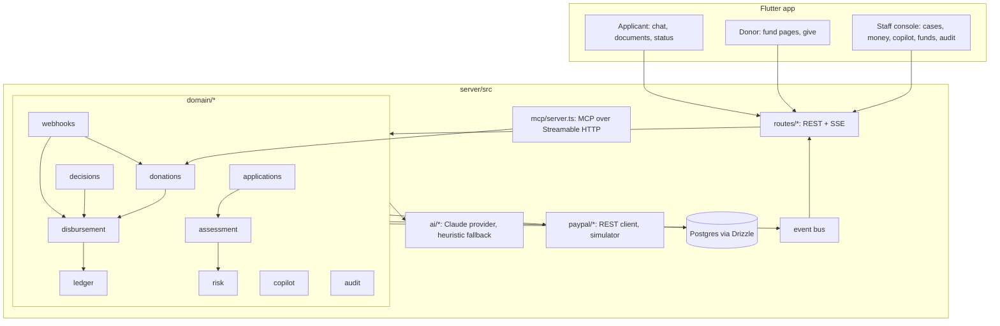
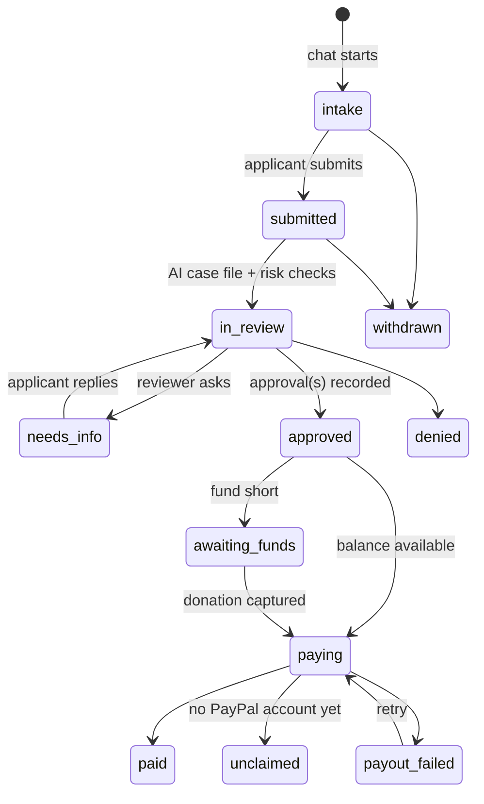

# Tideover architecture

Tideover is one TypeScript server and one Flutter app. The server is the source of truth for every case, gift and payout and the only component that talks to PayPal or Claude. The Flutter app (web, iOS, Android) is a thin client over its REST and Server-Sent Events API.

## Principles

1. **AI proposes, people decide, rules enforce.** Claude interviews, reads documents and writes the case file. Only a person approves a grant (or, if organizers opt in, a deterministic gate for small, clean, verified cases). Money rules live in plain code the AI can't reach.
2. **Money moves exactly once.** Every payout is idempotent end to end, and every state change is recorded in the ledger and audit log.
3. **Same code against the simulator and the sandbox.** The domain only sees the `PayPalGateway` interface.
4. **Dignity by default.** No account and no SSN to ask for help, any language, private link, and public stories only with consent and only in anonymized form.

## Request lifecycle

- **Assessment** (`domain/assessment.ts`) runs as a background job after submission and after new documents or replies. It gathers facts, documents, prior grants and risk flags, asks the AI for a structured `Assessment` (recommendation, amount, confidence, per-criterion verdicts with evidence, questions, risk notes), clamps the amount to the documented need and caps, and evaluates the **auto-approval gate**: auto-approval must be enabled, the AI must recommend approval with confidence ≥ 0.8 within the fund's limit, there must be no risk warnings, the payout account must be verified with PayPal, and a supporting document must be present when the category expects one.
- **Decisions** (`domain/decisions.ts`) record each reviewer's approval. `approvalsRequired = max(fund.approvalsRequired, amount > dualApprovalAbove ? 2 : 1)` counts *distinct* reviewers, so the same person approving twice doesn't count. Denials and information requests produce an applicant-facing message in the applicant's language.
- **Risk checks** (`domain/risk.ts`) are deterministic and run before the AI sees the case: `cooldown_recent_grant`, `duplicate_open_request`, `duplicate_document` (SHA-256 of uploads), `similar_story` (word-trigram overlap with recent requests to other receivers), `velocity_device`, `amount_over_cap`, `doc_amount_mismatch`, `doc_red_flags`, `no_document`, `unverified_payout`, `paypal_unverified_account`. Each is `info`, `warn` or `block`. The AI explains them; it can't clear them.

## Money

### Disbursement (`domain/disbursement.ts`)

1. Under a per-fund lock, re-read the case and the fund's ledger balance. Pay only `approved`, `awaiting_funds` or `payout_failed` cases, never above the approved amount, and never if the balance minus the estimated payout fee would go negative (the case moves to `awaiting_funds` instead).
2. Insert the payout row with `sender_batch_id = TDO_<payoutId>` *before* calling PayPal.
3. Call Payouts with that `sender_batch_id` and a `PayPal-Request-Id`. A transient failure (network, 5xx, 429) leaves the row `pending`, and the poller retries with the same keys, so PayPal deduplicates. A 4xx is final and marks the case `payout_failed` with PayPal's reason.
4. Post the payout and fee to the ledger and the audit log.
5. Converge: `PAYMENT.PAYOUTS-ITEM.*` webhooks and a poller (every few seconds while in flight) both feed one `syncPayout` state machine: `pending → processing → success | unclaimed | failed | returned | blocked | held | canceled`. Returned or failed money is credited back to the ledger.

### Donations (`domain/donations.ts`, `routes/donations.ts`)

- A hosted checkout page (`/give/checkout/:id`) renders PayPal JS SDK Smart Buttons (PayPal, Venmo, Pay Later, cards). `createOrder` and `onApprove` call the server, which creates the Orders v2 order (`custom_id` = donation id) and captures it. A redirect flow handles native apps and agent checkouts.
- On capture (API response or `PAYMENT.CAPTURE.COMPLETED`, whichever comes first), the gross and PayPal fee are posted to the ledger. If the gift sponsors an approved need, disbursement runs immediately.
- Refunds (`PAYMENT.CAPTURE.REFUNDED/REVERSED` or the copilot's confirmed `refund_donation`) reverse the ledger entries.

### Ledger and reconciliation

`ledger_entries` is append-only: donations, donation fees, payouts, payout fees, returns and refunds, each pointing at its source row. A fund's available balance is the sum of its entries. The copilot's `reconcile_with_paypal` compares captures and payouts against PayPal Transaction Search in both directions, so it catches records PayPal doesn't show and PayPal payments Tideover never recorded.

## AI layer (`ai/*`)

`AiProvider` has two implementations behind one interface:

| Task | Claude feature | Fallback |
|---|---|---|
| Intake chat | Streaming tool loop with `record_details`, `request_document` and `mark_ready` (eager input streaming, inputs validated with zod); cached system prompt with the fund's policy | Keyword rules |
| Document reading | Vision (image/PDF blocks) + structured output (`DocumentSchema`) | "Received, not analysed" |
| Case assessment | Structured output (`AssessmentSchema`), high effort, cached rubric prompt | Rule-based recommendation |
| Policy compiler | Structured output (`RubricSchema`), high effort | Category keyword extraction |
| Decision messages, stories | Plain generation, low effort | Templates in English/Spanish |
| Treasurer copilot | Tool loop over Tideover tools + PayPal Agent Toolkit | Intent rules + readable summaries |

All requests use `claude-opus-5-5` with adaptive thinking, per-task `effort`, and server-side fallbacks. Every structured output is validated before use, every amount is clamped by code, and prompts treat applicant text and document contents as evidence, never instructions. Protected characteristics are excluded from intake questions, assessment and compiled rubrics.

## PayPal integration (`paypal/*`)

- `rest.ts`: OAuth2 client-credentials with a cached token, Orders v2, Payouts v1 (batch + item lookup, cancel unclaimed), refunds, Log in with PayPal (authorization code → `userinfo?schema=paypalv1.1`, so payouts go to the verified `payer_id`), `verify-webhook-signature`, and Transaction Search. PayPal errors become `PayPalApiError` carrying `debug_id` and issue codes.
- `simulator.ts`: an in-process PayPal with the same wire formats and state machines (`CREATED → APPROVED → COMPLETED`, payouts `PENDING → SUCCESS/UNCLAIMED/FAILED/BLOCKED`), idempotency, error shapes, fees, webhooks, and hosted checkout and login pages with sandbox-style personas. Its history is rebuilt from the database at boot, so it survives restarts.
- The copilot also loads `@paypal/agent-toolkit` tools when real credentials are configured.

## Agentic giving (`mcp/server.ts`)

A stateless MCP server at `POST /mcp` (Streamable HTTP) exposes `list_funds`, `find_needs`, `get_impact`, `create_donation` and `get_donation_status`. `create_donation` returns a PayPal checkout link that the human must approve; agents can't move money on their own. Gifts are stored with `source = "agent"` and the agent's name.

## Realtime

An in-process event bus publishes to SSE channels: `app:<id>` (the applicant's private page), `fund:<id>` (public fund pages), `staff` (console) and `copilot:<userId>`. Events carry `{type, data, at}`; clients re-fetch or patch state.

## Data model

`users`, `funds` (policy text, compiled rubric, caps, approval rules), `applications`, `messages`, `documents` (bytes, SHA-256, extraction), `reviews`, `donations`, `payouts`, `ledger_entries`, `audit_events`, `webhook_events` (deduplicated by PayPal event id), `copilot_messages`. Postgres in production; PGlite (embedded Postgres) for development and tests, so the same SQL runs everywhere.

## Security and privacy

- Applicants get an unguessable private link; only a hash of its token is stored. Staff use JWT sessions with `admin` and `reviewer` roles. Rate limits apply to login, chat and copilot.
- Documents are only served to staff. Public pages show anonymized, consented stories, amounts and timings, never names or receivers. Payout receivers are masked in applicant-facing messages.
- Webhooks are verified with PayPal's signature API and processed idempotently.
- Intake never asks for SSNs, bank numbers, immigration status or diagnoses, and points people in danger to 988/911.

## Deployment

One Docker image (`Dockerfile`): stage 1 builds the Flutter web app, stage 2 builds the server, and the runtime stage serves the API, the checkout page and the web app from one origin, with Brotli/gzip compression and a health check at `/api/health`. `render.yaml` provisions the service and a Postgres database. Configuration is entirely through environment variables (`server/.env.example`).
